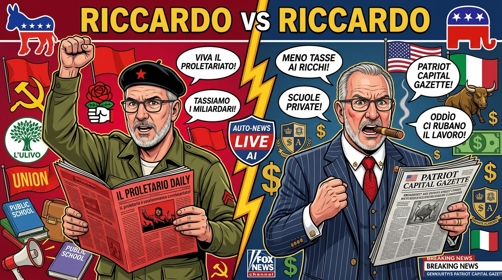

# Auto-News (`auto-news`) — *Riccardo vs Riccardo*

> **Platform Host**: Vertical #1 on [`doug`](../../meta/doug/SPEC.md) (`~/git/doug`).  
> Per `respec` rules, this directory contains **specifications and initial hero assets only** (zero application code).

## Contents

- **[`SPEC.md`](SPEC.md)** — Functional & editorial specification for the self-updating satirical Left-Wing vs Right-Wing newspaper across US 🇺🇸, Italian 🇮🇹, Swiss 🇨🇭, and World 🌍 politics.
- **[`input_prompt.md`](input_prompt.md)** — Original prompt & editorial contract.
- **[`blueprint.yaml`](blueprint.yaml)** — Link to the `doug` host repo.
- **[`extras/riccardo-vs-riccardo-hero.jpg`](extras/riccardo-vs-riccardo-hero.jpg)** — NanoBanana Character-Consistent split-screen hero banner (*Compagno Riccardo* vs *Tycoon Riccardo*).
