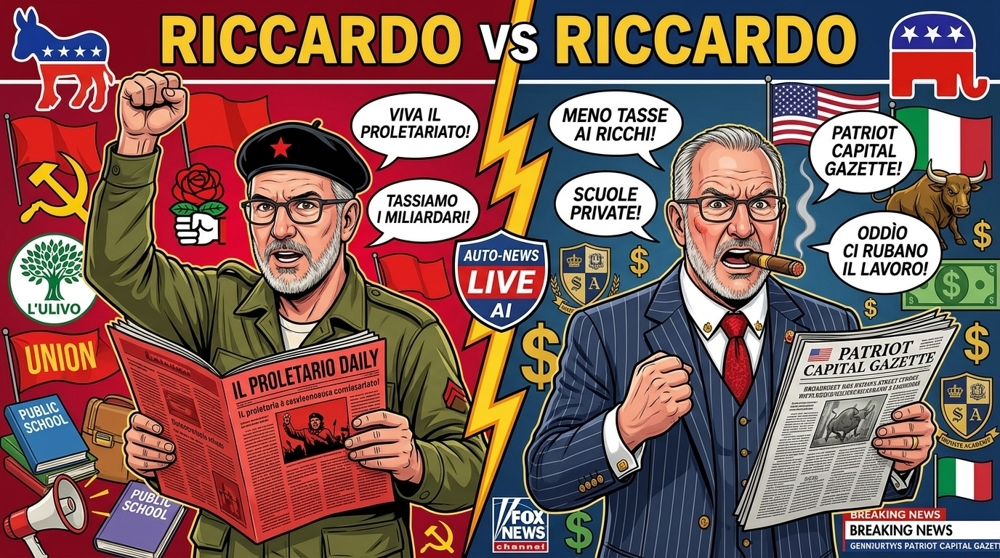
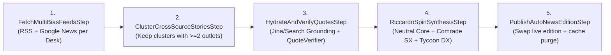

# Auto-News (`auto-news`) — *Riccardo vs Riccardo*

**Vertical Specialization #1 on [`doug`](../../meta/doug/SPEC.md): A Self-Updating Satirical Political & World Newspaper Contrasting Ultra-Left "Compagno Riccardo" vs Ultra-Right "Tycoon Riccardo" Around a Sacred, Verbatim-Quoted Factual Core.**

---

## 1. Concept & Editorial Contract

Modern political media already reads like unintentional parody. **Auto-News** makes the joke explicit—while ironically delivering better source transparency than real aggregators:

1. **Multi-Source Requirement (`>= 2` Distinct Outlets)**: A story only enters an edition if the crawler corroborates it across **at least two distinct news organizations** (ideally across the spectrum, e.g., *Fox News* + *NYT/AP* in the US; *Il Giornale/Libero* + *La Repubblica/Il Manifesto* + *ANSA* in Italy; *NZZ/Blick* + *Tages-Anzeiger/RSI* in Switzerland).
2. **The Sacred Center Box ("⚖️ Cosa è Successo Davvero & Fonti Verificate")**:
   - Strictly neutral, factual summary of the event (`3–5` bullet points).
   - **100% Verbatim Source Quotes**: Direct quotes with clickable publisher badges (`[Fox News]`, `[NYT]`, `[ANSA]`, `[NZZ]`), publication timestamps, and `Doug::QuoteVerifier` green verification checkmarks. **Zero LLM invention allowed inside quotation marks.**
3. **The Satirical Flanks ("🚩 Compagno Riccardo" vs "🎩 Tycoon Riccardo")**:
   - **Left Flank — *Il Proletario Daily* (Compagno Riccardo)**: Styled with Riccardo's Che Guevara beret avatar. Interprets the exact same verified facts through an over-the-top Marxist-proletarian-unionist lens (*"Ancora una volta il capitale affama il proletariato! Tassiamo i miliardari al 99%! Viva la scuola pubblica!"*).
   - **Right Flank — *Patriot Capital Gazette* (Tycoon Riccardo)**: Styled with Riccardo's pinstripe-suit-and-cigar Wall Street avatar. Interprets the exact same verified facts through a hyper-capitalist / conservative cable-pundit lens (*"Meno tasse ai ricchi che creano PIL! Tutto privatizzato, scuole private subito, e oddìo questi immigrati ci rubano il lavoro!"*).
   - **Explicit Satire Watermark**: Every card clearly badges both flanks as *AI Political Parody* so comedic commentary is never confused with real reporting.

---

## 2. Coverage Desks & Source Matrix

| Desk | Tab Badge | Curated Seed Feeds & Grounding Targets |
| :--- | :--- | :--- |
| **US Politics** | 🇺🇸 `USA` | Fox News Politics, New York Post, WSJ Opinion, NYT Politics, NPR, AP News, Politico |
| **Italian Politics** | 🇮🇹 `Italia` | ANSA Politica, La Repubblica, Il Post, Il Manifesto, Il Giornale, Libero, Corriere della Sera |
| **Swiss Politics** | 🇨🇭 `Svizzera` | RSI News, Neue Zürcher Zeitung (NZZ), Tages-Anzeiger, Blick, Swissinfo (IT/DE/FR/EN) |
| **World Affairs** | 🌍 `Mondo` | Reuters, BBC World, Al Jazeera, Le Monde, Der Spiegel, Financial Times |

*Language Output*: Primary site edition in **Italian** (with optional toggle to read original-language verbatim quotes in EN/DE/FR alongside Italian translations).

---

## 3. Workflow DAG on `doug`

Scheduled every **6 hours** (`0 */6 * * *` Europe/Zurich) via [`doug`](../../meta/doug/SPEC.md):

### Step Contract Details
1. **`FetchMultiBiasFeedsStep`**: Pulls latest 12h items across the 4 Desks via `Doug::Crawler` Tier 1 RSS. Outputs normalized candidate URLs + headlines.
2. **`ClusterCrossSourceStoriesStep`**: Uses embeddings / fast `gemini-3.8-flash` structured clustering to group articles covering the same underlying event, selecting the top `3` clusters per Desk that have **at least 2 independent outlets**.
3. **`HydrateAndVerifyQuotesStep`**: Fetches clean article text (`Tier 2 Jina` -> `Tier 3 Gemini Search Grounding`), extracts `2–4` salient verbatim passages per cluster, and enforces `Doug::QuoteVerifier` (`quote_verified == true`). If a cluster yields `< 2` verified sources, it is dropped cleanly rather than hallucinated.
4. **`RiccardoSpinSynthesisStep`**: Single structured-output `gemini-3.8-flash` call per story producing `AutoNewsStoryPayload`:
   - `neutral_headline`, `factual_bullets[]`
   - `left_wing`: `{ satirical_headline, body_markdown, outrage_meter_1_to_10, catchphrase }`
   - `right_wing`: `{ satirical_headline, body_markdown, outrage_meter_1_to_10, catchphrase }`
5. **`PublishAutoNewsEditionStep`**: Writes `Edition` + `ContentItem` + `SourceCitation` rows in PostgreSQL and flips the edition live.

---

## 4. Public UI / UX Design

- **Masthead**: Features the split-screen **[`riccardo-vs-riccardo-hero.jpg`](extras/riccardo-vs-riccardo-hero.jpg)** banner, edition timestamp (*"Edizione delle 06:00 CET — Aggiornata automaticamente da AI"*), and Desk filter tabs (`🔥 Tutte`, `🇺🇸 USA`, `🇮🇹 Italia`, `🇨🇭 Svizzera`, `🌍 Mondo`).
- **Interactive Political Dial / "La Rotella" (Primary UX, Desktop & Mobile)**:
  - Each story (and a global header master dial) starts centered at **`0` — ⚖️ Versione Neutrale** (crisp white background, neutral synthesis + 100% verified verbatim source quotes & links).
  - Turning/dragging the **rotella to the Left (`SX`)** smoothly morphs the theme, avatar, headline, and article into the **🔴 Versione Rossa** (*🚩 Compagno Riccardo — Il Proletario Daily*).
  - Turning/dragging the **rotella to the Right (`DX`)** smoothly morphs the theme, avatar, headline, and article into the **🔵 Versione Blu** (*🎩 Tycoon Riccardo — Patriot Capital Gazette*).
  - Optional **"Vista Confronto 3 Colonne"** toggle expands Rossa (SX) | Neutrale (Centro) | Blu (DX) side-by-side on wide screens.

---

## 5. Acceptance Criteria

1. Every published story displays **at least 2 clickable, real external source links** and verbatim quotes verified against source text (`quote_verified == true`).
2. Zero fabricated quotes appear inside the Left or Right satirical columns; both columns riff strictly on the facts established in the Center box.
3. Failing `HydrateAndVerifyQuotesStep` for one desk or failing `RiccardoSpinSynthesisStep` mid-run is visible in `/admin/workflow_runs/:id` and recoverable via **1-click Retry from Failed Step**.
