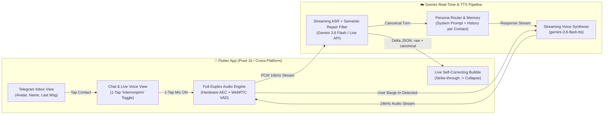
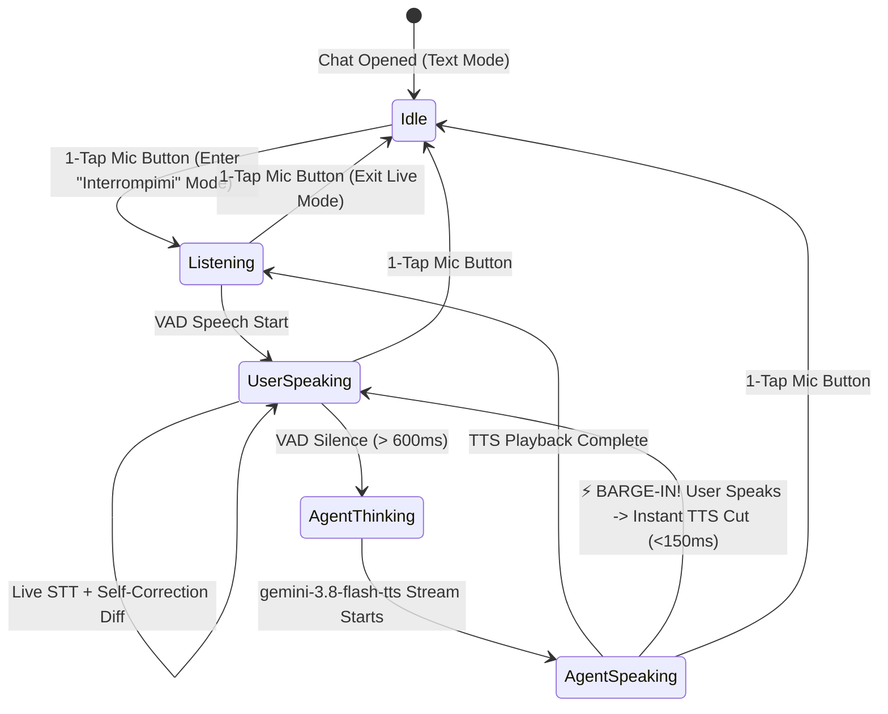

# 📱🎙️ `telegram-voice-agents`: Telegram-Style Multi-Persona Voice & Live Self-Correcting Chat

> *BTW: queste specifiche sono implementate in [`github.com/palladius/korybantes`](https://github.com/palladius/korybantes) (vedi [`blueprint.yaml`](blueprint.yaml) e [`README.md`](README.md)).*

## Problem Statement

Modern AI voice interfaces force users into an uncomfortable binary choice:
1. **Asynchronous voice memos (Telegram / WhatsApp style)**: Great multi-contact inbox UI, but turn-based, high-latency, no barge-in interruption, and full of verbal stumbles (*"ehm, volevo dire..."*) that get transcribed verbatim.
2. **Single-persona live voice orbs (ChatGPT Voice / Gemini Live overlay)**: Great full-duplex barge-in, but detached from a familiar multi-agent/multi-persona messaging inbox, and their transcripts blindly log raw speech disfluencies instead of the speaker's **intended, self-corrected message**.

When speaking naturally on the go (especially one-handed on a **Google Pixel 10**), humans constantly self-repair mid-sentence:
> *"Voglio un gelato alla crema, anzi no, al pistacchio"*  
> (10 words spoken $\rightarrow$ 5 intended words: **"Voglio un gelato al pistacchio"**).

There is no portable, cross-platform **Flutter** client that combines a **Telegram-like contact/agent list** with a **single-tap hands-free "Interrupt-Me" (barge-in) full-duplex voice mode** powered by **`gemini-3.8-flash-tts`**, paired with a **real-time semantic self-correction transcript engine** that rewrites repairs in-place as you speak.

---

## Goals

1. **Cross-Platform Flutter Frontend (Pixel 10 First)**:
   - Single codebase in **Flutter (Dart)** running natively on **Android (optimized for Google Pixel 10**: 120Hz Smooth Display, Material 3 Expressive dynamic color, Tensor G5 low-latency audio path, edge-to-edge gestures, haptic ticks), plus Web, Linux, macOS, and iOS.
2. **Telegram-Style Home Index (Contact / Persona Inbox)**:
   - Familiar, dense, zero-latency list view sorted by `last_message_at DESC`.
   - Each row displays:
     - **Avatar Icon** (circular image/emoji badge + online/speaking status ring).
     - **Persona / Agent Name** in bold (e.g., *Frau Leonie 🐎*, *Benjamin SRE 🚨*, *Ermete Bottazzi 🚛*, *Chef Pistacchio 🍦*).
     - **Last Chat Snippet** in small muted text (`maxLines: 1`, `TextOverflow.ellipsis`), prefixed with `🎙️` or `✏️` and timestamp / unread badge.
3. **Dual-Modal Conversation View (Text + 1-Tap Live Voice)**:
   - Tapping any persona opens a Telegram-style chat thread showing historical bubbles (clean transcripts + expandable raw audio waveform).
   - Bottom composer bar supports instant keyboard typing **or** a prominent **Single-Tap Microphone Toggle**.
4. **1-Tap "Interrompimi" (Barge-In Full-Duplex Mode) with `gemini-3.8-flash-tts`**:
   - **Press Once to Enter, Press Again to Exit**: No "hold-to-talk" fatigue. A single tap switches the thread into active **Hands-Free Barge-In Mode**.
   - **Full-Duplex Interruption**: While the persona is speaking via **`gemini-3.8-flash-tts`** (supporting prosody tags, natural pacing, and per-persona voice profiles), the user can speak at any moment to interrupt. Client-side Voice Activity Detection (VAD) + acoustic echo cancellation (AEC) cuts TTS playback within `< 150ms` and yields the floor to the user.
5. **Live Self-Correcting Transcript ("10 Spoken $\rightarrow$ 7 Written")**:
   - As the user speaks, a live streaming draft bubble renders words in real time, but applies **Semantic Disfluency & Repair Collapse**:
     - Detects conversational backtracking markers in Italian, English, and German (*"anzi no"*, *"scusa volevo dire"*, *"cioè"*, *"o meglio"*, *"wait no"*, *"I mean"*, *"ach nein, ich meine"*).
     - **Visual Strike-Through & Collapse Animation**: Briefly highlights the retracted span (*"~~alla crema, anzi no,~~"*) for `300ms` with a subtle haptic tick on Pixel 10, then collapses it into the clean canonical sentence:
       - Raw spoken (9–10 words): `"voglio un gelato alla crema, anzi no, al pistacchio"`
       - Committed transcript (5 words): `"Voglio un gelato al pistacchio."`
     - Tapping an info icon (`ⓘ`) on any voice bubble toggles the *Raw Verbatim Diff* for transparency/debugging.

---

## Non-Goals

- **End-to-End Encrypted P2P Human Messenger**: This is an AI persona / agent communication frontend, not a replacement for WhatsApp/Telegram human-to-human E2EE messaging.
- **Hold-to-Record Walkie-Talkie Only**: While async voice notes can be sent, the primary design center is **1-tap continuous full-duplex conversation**.
- **Heavy Native-Only UI Forks**: Avoid maintaining separate Kotlin/Swift/React codebases; 95%+ of UI and state logic must stay in portable Flutter/Dart.

---

## Technical Plan / Approach

### 1. System Architecture



### 2. Live Self-Correction Engine (Semantic Repair Pipeline)

Instead of waiting for the end of a turn to clean up speech, the transcription stream maintains a **Two-Tier Token Buffer**:
- **`raw_buffer`**: Append-only stream of every word recognized by STT.
- **`canonical_buffer`**: The active, self-corrected sentence displayed in the chat bubble and fed to the agent's context window.

#### Examples of Canonical Collapse Rules

| Spoken Input (`raw_buffer`) | Word Count | Self-Corrected Output (`canonical_buffer`) | Word Count |
| :--- | :---: | :--- | :---: |
| *"Voglio un gelato alla crema, anzi no, al pistacchio"* | 9 | **"Voglio un gelato al pistacchio"** | 5 |
| *"Fissa il meeting alle tre, scusa alle quattro e mezza"* | 10 | **"Fissa il meeting alle quattro e mezza"** | 7 |
| *"Mandalo a Marco, cioè no a Luca domani mattina"* | 9 | **"Mandalo a Luca domani mattina"** | 5 |
| *"ehm... allora... diciamo che partiamo lunedì"* | 6 | **"Partiamo lunedì"** | 2 |

#### Structured Streaming Payload (Server/Model $\rightarrow$ Flutter UI)
```json
{
  "turn_id": "turn_042",
  "is_final": false,
  "raw_transcript": "voglio un gelato alla crema anzi no al pistacchio",
  "retracted_spans": ["alla crema anzi no"],
  "canonical_transcript": "Voglio un gelato al pistacchio",
  "word_compression_ratio": "9 -> 5"
}
```

### 3. Single-Tap "Interrompimi" (Barge-In) State Machine



### 4. Pixel 10 & Flutter Hardware Optimizations
- **Audio Pipeline**: Uses `flutter_webrtc` or `record` + `just_audio` / native Android `AAudio` (`PERFORMANCE_MODE_LOW_LATENCY`) with hardware **Acoustic Echo Cancellation (`VOICE_COMMUNICATION` audio source)** on Pixel 10 so the microphone never hears the speaker output of `gemini-3.8-flash-tts` as a false barge-in.
- **Haptics & Visuals**:
  - `HapticFeedback.lightImpact()` when a self-correction collapses (*"anzi no"* $\rightarrow$ snap!).
  - `HapticFeedback.mediumImpact()` when barge-in interrupts the agent.
  - Material 3 dynamic color theming (`dynamic_color`) matching the Pixel 10 wallpaper, plus a floating pill indicator at the top of the chat: `🟢 Interrompimi attivo · gemini-3.8-flash-tts`.

---

## Alternatives Considered

- **Native Android (Jetpack Compose / Kotlin) Only**:
  - *Pros*: Direct access to Android `AudioRecord`/`AudioTrack`.
  - *Cons*: Violates portability to Desktop/Web/iOS. Flutter with native low-latency audio plugins achieves the same `<150ms` barge-in while compiling everywhere.
- **Post-Turn Batch Cleanup (Wait until user stops speaking to rewrite)**:
  - *Pros*: Simpler prompt engineering.
  - *Cons*: The user sees the wrong words sitting on screen while speaking and loses confidence that the AI understood the correction. Streaming incremental repair (with strike-through collapse) gives immediate visual confirmation.
- **Hold-to-Talk (WhatsApp / Telegram Voice Note UX)**:
  - *Pros*: Zero VAD false positives.
  - *Cons*: Exhausting for multi-turn conversations and prevents natural interruption while the AI is talking.

---

## Implementation Plan

1. **Phase 1 — Flutter Skeleton & Telegram Inbox (`lib/screens/inbox_screen.dart`)**:
   - Build the Material 3 Telegram-style list with `CircleAvatar`, Persona title, timestamp, unread counter, and 1-line `lastMessage` preview.
   - Local persistence via `drift` (SQLite) or `isar` for instant offline startup on Pixel 10.
2. **Phase 2 — Chat Thread & Dual Composer (`lib/screens/chat_screen.dart`)**:
   - Message bubble list supporting Markdown, inline audio playback, and a `raw vs. canonical` toggle chip (`10 → 5 parole`).
   - 1-Tap Microphone toggle button with pulsing animated ring when `"Interrompimi"` mode is active.
3. **Phase 3 — Full-Duplex Audio & Barge-In (`lib/services/live_voice_service.dart`)**:
   - Configure Android `VOICE_COMMUNICATION` hardware AEC/NS on Pixel 10.
   - Connect bidirectional WebSocket / gRPC stream to Gemini Live + `gemini-3.8-flash-tts` with per-persona voice configurations.
   - Implement `<150ms` local audio buffer flush on VAD barge-in detection.
4. **Phase 4 — Live Self-Correcting Transcript Widget (`lib/widgets/self_correcting_bubble.dart`)**:
   - Implement streaming token diffing (`AnimatedSwitcher` / `RichText` strike-through fade-out) so verbal repairs (*"alla crema, anzi no, al pistacchio"*) visibly contract in real time.

---

## Open Questions

1. **Backend Topology**: Should the Flutter app connect **directly** to the Gemini API / Vertex AI from the device (via BYOK / OAuth token on Pixel 10), or route through a lightweight Cloud Run / ADK backend proxy that manages the personas?
2. **Correction Aggressiveness Slider**: Should each persona have a configurable transcription style (e.g. *Strict Verbatim* for language learning in Hummerli vs. *Aggressive Self-Correction* for task/assistant personas)?
3. **Wake-Word / Screen-Off Continuation**: On Pixel 10, once the user taps the microphone once to enter *"Interrompimi"* mode, should the session stay alive via an Android Foreground Service when the screen locks or the user switches apps?
