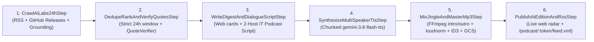

# What's Up With AI (`whats-up-with-ai`)

**Vertical Specialization #2 on [`doug`](../../meta/doug/SPEC.md): A Self-Updating 24-Hour AI Intelligence Radar & 5–7 Minute Sparkling Italian Morning Podcast Bookended by a Comedic 80s Synth-Funk Jingle.**

---

## 1. Problem Statement & Morning Ritual

In GenAI, missing 7 days of model releases, SDK shifts, benchmark drama, and agentic tooling makes you feel prehistoric. Yet skimming 15 blogs, Hacker News threads, ArXiv drops, and X threads before 07:30 AM is unsustainable.

**What's Up With AI** automates Riccardo's morning briefing:
- Every morning at **05:30 CET/CEST** (while Riccardo is asleep), [`doug`](../../meta/doug/SPEC.md) wakes up on Cloud Run.
- Crawls everything shipped or leaked in the **last 24 hours** across **OpenAI, Anthropic, Google / DeepMind, xAI / Grok, Meta AI, Mistral, HuggingFace, Simon Willison, and Hacker News**, extracting verified source quotes and links.
- Produces both a **scannable 24h Web Radar** (filterable by lab) AND a **5–7 minute Italian 2-host morning radio podcast** (`gemini-3.8-flash-tts`), wrapped in the signature **Lyria 3 comedic synth-funk jingle** ([`extras/whats-up-with-ai-jingle.mp3`](extras/whats-up-with-ai-jingle.mp3)), ready on the web and in Riccardo's private **Apple Podcasts / Pocket Casts RSS feed** before he hops on his bike in Zurich.

---

## 2. Signature Audio Branding (Reference Jingle)

Bundled in [`extras/whats-up-with-ai-jingle.mp3`](extras/whats-up-with-ai-jingle.mp3) (lyrics & arrangement in [`extras/whats-up-with-ai-jingle.txt`](extras/whats-up-with-ai-jingle.txt) — 120 BPM 1980s Synth-Funk with slap bass & DX7 brass stabs):

> 🎵 `[00:00]` *"Sveglia! What's up with A.I.!"*  
> 🎵 `[00:04]` *"Se sei rimàsto indiètro di una settimàna... you're out of your job!"*  
> 🎵 `[00:10]` *"Rimarrài prèsto senza lavóro, sei uno sfigàto!"*  
> 🎵 `[00:16]` *"Open A.I., Anthròpic, Google e Grok... ascolta il podcast o sei già obso-lè-to!"*  
> 🎵 `[00:22]` *"What's up with A.I.!"*

### Audio Mastering Rules (`FFmpeg` Step)
- **Intro**: Full ~25s jingle plays crisp at `-16 LUFS`, ducking smoothly (`-14 dB` fade over `1.5s`) under the hosts' opening greeting (*"Buongiorno Riccardo! Vediamo chi ha provato a rubarci il lavoro stanotte..."*).
- **Body (`5–7 min`)**: Two contrasting, witty Italian voices synthesized via **`gemini-3.8-flash-tts` Multi-Speaker**:
  - **Host A (*"L'Entusiasta Hype-Hunter"*)**: Breathless about benchmarks, new APIs, and agentic tricks.
  - **Host B (*"L'SRE Cinico Carlessiano"*)**: Roasts pricing traps, fake benchmarks, missing evals, and vendor lock-in, citing exact numbers & quotes from the sources.
- **Outro**: 8-second tail sting of the jingle (`[00:18–00:26]`).
- **Quiet-Day Graceful Mode**: If `< 2` major releases happened in the last 24h (e.g., quiet Sunday), generates a tight **90-second "Domenica Tranquilla" flash briefing** instead of padding fluff.

---

## 3. Tracked AI Ecosystem & Radar Sources

| Lab / Pillar | Pill Tag | Primary Crawled & Grounded Sources |
| :--- | :--- | :--- |
| **Google & DeepMind** | 🟦 `Google` | Google AI Blog, DeepMind Blog, Vertex AI / Cloud Release Notes, `google-gemini` GitHub releases |
| **Anthropic** | 🟧 `Anthropic` | Anthropic News, Claude Docs Changelog, `anthropics` GitHub releases, MCP announcements |
| **OpenAI** | 🟩 `OpenAI` | OpenAI News, Platform Changelog, `openai` GitHub releases |
| **xAI / Grok** | ⬛ `Grok / xAI` | `x.ai/blog`, xAI API docs & Gemini Search Grounding for Grok release announcements |
| **Open Weights & Ecosystem** | 🟪 `Open / Meta / Mistral` | Meta AI, Mistral AI, HuggingFace Daily Papers, Qwen/DeepSeek major drops |
| **Builder Pulse** | 🟨 `HN & Builders` | Simon Willison's Weblogatom feed, Latent Space, Hacker News frontpage AI threads (`points >= 150`) |

---

## 4. Workflow DAG on `doug`

Scheduled daily at **`30 5 * * *` (`05:30` Europe/Zurich)** on [`doug`](../../meta/doug/SPEC.md):

### Why the Visual DAG Debugger Matters Here
Steps `4` (`SynthesizeMultiSpeakerTtsStep`) and `5` (`MixJingleAndMasterMp3Step`) are the classic points where daily AI podcast pipelines fail (TTS segment timeout, malformed SSML/pause tag, GCS upload hiccup). Because `doug` checkpoints Step `3`'s complete `dialogue_script_json` and `web_cards_json` in PostgreSQL:
- If Step `4` fails on segment `3/5`, `/admin/workflow_runs/:id` shows Node `4` in **RED** with the exact TTS error log.
- Clicking **"🔁 Retry from Step 4"** re-runs *only* TTS + FFmpeg + Publish—keeping the exact same curated 24h news digest and script.

---

## 5. Delivery Channels (Web Player + Commute Podcast RSS)

1. **Web Radar (`/s/whats-up-with-ai` or dedicated domain)**:
   - Sticky top **Morning Episode Player** with waveform/progress scrubber, `1.25x / 1.5x` speed toggle, and **clickable chapter pills** (`[00:25 Google]`, `[02:10 Anthropic]`, `[03:45 OpenAI]`, `[05:10 Grok]`) that seek the audio directly.
   - **24h Structured Cards Below**: Grouped by Lab pill, each card showing a 2-sentence Italian takeaway, *"Perché ti tocca"*, and **verified verbatim English quotes + direct source links**.
2. **Private Authenticated Podcast RSS (`/podcast/:secret_token/feed.xml`)**:
   - Valid iTunes / Podcasting 2.0 RSS 2.0 XML (`<enclosure url="https://storage.googleapis.com/..." type="audio/mpeg"/>`, `<itunes:duration>`, `<psc:chapters>`).
   - Subscribe once on Pixel / iPhone (Pocket Casts, AntennaPod, Apple Podcasts); every morning at `05:35` the new episode auto-downloads for offline listening on the bike or train.

---

## 6. Acceptance Criteria

1. **Strict 24h Freshness & Zero Duplicate Rehash**: Stories already covered in yesterday's `Edition` (matched by canonical URL or semantic cluster fingerprint) are excluded unless a material update occurred.
2. **End-to-End Audio Production**: Produces a valid stereo `.mp3` normalized to `-16 LUFS` containing the bundled Lyria 3 intro jingle, 2-speaker Italian dialogue, ID3v2 chapter/cover tags, and outro sting, stored on GCS.
3. **Valid Podcast Feed**: `/podcast/:token/feed.xml` validates cleanly against standard podcast RSS parsers and plays immediately in mobile podcast apps and the web chapter player.
4. **Admin Step-Level Recovery**: Killing `MixJingleAndMasterMp3Step` mid-run leaves Steps `1..4` green in `/admin` and recovers cleanly on single-step retry.
