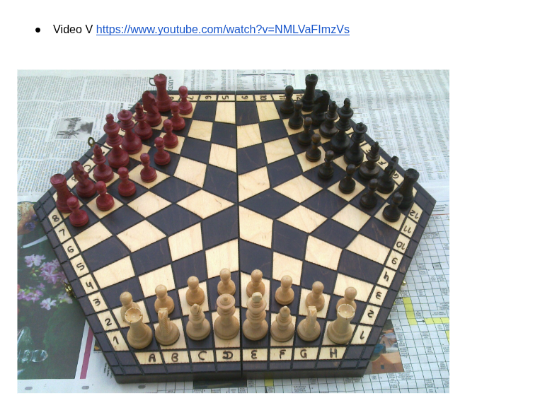
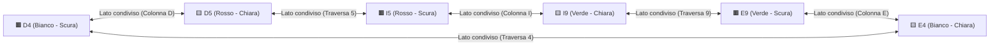

# 🇮🇹♟️🔺 Scacchi Tricolore 3D (`CarChess3`)
*(Gioco Didattico e Pragmatico di Scacchi a 3 Giocatori — Bianco, Rosso e Verde per Papà Riccardo, Ale & Seby)*

  

> 🎥 **Video Regolamento di Riferimento**: [`https://www.youtube.com/watch?v=NMLVaFImzVs`](https://www.youtube.com/watch?v=NMLVaFImzVs) (*"How to play 3 Player Chess"* — Triple S Games)
> 📄 **Appunti Ufficiali di Riccardo (Google Doc)**: [`Regole Scacchi a 3`](https://docs.google.com/document/d/1ztb0he8aDtqgzpmq_pQGncOVvNn3jxCw61pJKM90zPg/edit?tab=t.0)
> 📸 **Scacchiera Fisica di Casa Carlesso**: [`assets/scacchiera_fisica_riccardo.png`](assets/scacchiera_fisica_riccardo.png) (Scacchiera esagonale pieghevole in legno pirografato a 96 caselle, coordinate `A..L` $\times$ `1..12`)

---

## 1. Problem Statement & Vision

Gli **Scacchi a 3 Giocatori** sono una variante straordinaria per giocare in famiglia (Papà Riccardo con Alessandro e Sebastian), ma presentano una barriera cognitiva iniziale molto alta quando si gioca sulla scacchiera fisica in legno:
1. **Geometria deformata della Rosetta centrale (`D4, D5, I5, I9, E9, E4`)**: Le 96 caselle quadrilatere convergono al centro con angoli di $60^\circ / 120^\circ$. Capire dove "sbuca" una Torre, un Alfiere, una Regina, un Cavallo o un Pedone quando interagisce con la **Rosetta centrale** è controintuitivo, specialmente per bambini di 6 e 8 anni.
2. **Coordinate pirografate `A..L` $\times$ `1..12` non banali**: Sulla scacchiera reale di Riccardo, le 12 colonne (`A..L`) e le 12 traverse (`1..12`) si piegano ad angolo da un settore all'altro (`A..D` collegano Bianco e Rosso, `E..H` collegano Bianco e il 3° giocatore, `I..L` collegano Rosso e il 3° giocatore).
3. **Eccesso di orpelli nei giochi 3D**: Mentre [`carchess3d`](https://github.com/palladius/carchess3d) punta sull'effetto cinema e sulle 36 battaglie animate Veo, per **insegnare e padroneggiare gli scacchi a 3** serve uno strumento **molto più pragmatico, veloce e funzionale**: zero filmati di combattimento che interrompono il flusso, e **100% chiarezza geometrica, didattica e tattica**.

**Scacchi Tricolore 3D (`CarChess3`)** risolve questo problema con una web-app **2D + 3D offline-first (PWA)** che replica al millimetro la scacchiera fisica di Riccardo e tutte le regole del suo Google Doc:
- I tre eserciti seguono i colori della bandiera italiana (**⚪ Bianco**, **🔴 Rosso**, **🟢 Verde** — con un toggle 1-click **`🪵 Colori Scacchiera Legno`** per mostrare il 3° esercito in **⚫ Nero/Ebano** come nella scatola fisica!) e si alternano con una **rotazione fluida della telecamera di $120^\circ$ a ogni mossa**.
- Cliccando (o passando col mouse) su qualsiasi pezzo, la scacchiera **illumina non solo le caselle di arrivo, ma l'intero albero dei raggi luminosi che si dipartono dal pezzo**, mostrando visivamente come le traiettorie curvano, rimbalzano o attraversano la Rosetta centrale sia in **3D** che in **2D**.
- Ogni postazione può essere **Umano** o **Computer** in qualsiasi combinazione (`1 Umano vs 2 CPU`, `2 Umani vs 1 CPU`, `3 Umani Hot-Seat`, oppure **`0 Umani — Auto-Play`** dove il gioco gioca da solo per mostrare le strategie).

> 🛑 **Nota di Repository (`respec`)**: Questo repository ospita esclusivamente le specifiche (`SPEC.md`, `input_prompt.md` e la foto di riferimento `assets/scacchiera_fisica_riccardo.png`). L'implementazione vive nel repository dedicato **[`palladius/tribecca`](https://github.com/palladius/tribecca)** (`~/git/tribecca`).

---

## 2. Goals & Non-Goals

### Goals (Obiettivi Primari)
- **Fedeltà 1:1 alla Scacchiera Fisica di Riccardo (`assets/scacchiera_fisica_riccardo.png`) & al Regolamento del Google Doc**:
  - Riproduzione esatta della **Scacchiera Esagonale a 96 Caselle (`A..L` $\times$ `1..12`)**, inclusi i numeri/lettere sul bordo, la cerniera centrale verticale (`tra D ed E in basso` e `tra 5 e 9 in alto`), e l'alternanza cromatica perfetta delle 96 caselle.
- **Killer Feature — Raggi Illuminati che si Dipartono (`MoveRayHighlighter`)**:
  - Selezionando un pezzo, il motore disegna **fasci luminosi animati (raggi continui e frecce direzionali `»`)** che partono dalla casella d'origine, attraversano ogni casella intermedia e mostrano chiaramente **deviazioni ortogonali e diagonali attraverso la Rosetta centrale**.
- **Doppia Visualizzazione Sincronizzata (`🎲 3D` ⇄ `📐 2D` + `🌓 Split Didattico`)**:
  - Passaggio istantaneo tra la vista **3D prospettica** (Three.js con pedine Staunton in legno/marmo e medaglioni zenitali) e la vista **2D geometrica** (SVG/Canvas ad altissima leggibilità con coordinate `A..L`/`1..12` identiche alla scacchiera vera), più modalità **Split-Screen** per tenere iPad/laptop accanto alla scacchiera di legno.
- **Rotazione Automatica di $120^\circ$ a Ogni Turno**:
  - Ad ogni cambio turno la visuale ruota dolcemente di $120^\circ$ in senso orario (con opzione per bloccarla sul giocatore umano o saltare istantaneamente a $0^\circ / 120^\circ / 240^\circ$).
- **Tutte le Combinazioni Umano / Computer (`3 Postazioni Indipendenti`)**:
  - Supporto completo per `1v2` (1 Umano contro 2 CPU), `2v1` (2 Umani — es. Ale e Seby o Papà e bimbo — contro 1 CPU), `3v0` (3 Umani al tavolo), e **`0v3` (3 CPU — Auto-Play / Spettatore)** con controllo di velocità (`0.5×`, `1×`, `2×`, `5×`, `Pausa/Step`).
- **Le 4 Modalità di Eliminazione / Vittoria del Google Doc di Riccardo**:
  1. **`💥 Destroy (Default di Riccardo)`**: I pezzi del giocatore sconfitto vengono rimossi dalla scacchiera e i 2 superstiti continuano.
  2. **`🔮 Assimilazione ("Protoss Conquer")`**: Chi dà scacco matto prende il controllo dei pezzi superstiti dello sconfitto.
  3. **`🪵 Relitti Inerti ("Flotsam / Obstacles")`**: Il giocatore matto esce dal gioco ma i suoi pezzi restano immobili come ostacoli catturabili che non muovono e non danno scacco.
  4. **`⚡ Sudden Death ("Primo Matto Vince")`**: La partita termina al primo scacco matto.

### Non-Goals (Cosa NON fa questo progetto)
- **Nessuna battaglia animata o video Veo 16:9**: Niente cutscenes di 10 secondi, niente shader pesanti o asset video da centinaia di MB. Il gioco deve avviarsi in `< 300 ms` e pesare `< 3 MB`.
- **Nessun backend o multiplayer online**: Tutto gira localmente nel browser / PWA offline-first.
- **Nessun marchio protetto da copyright nel codice/UI**: Design 100% originale e IP-safe (es. nella UI l'opzione *Protoss Conquer* degli appunti viene chiamata *"🔮 Conquista / Assimilazione Esercito"*).

---

## 3. Analisi Matematica della Scacchiera Fisica (`96 Caselle`, `A..L` $\times$ `1..12`)

Dall'analisi diretta della fotografia [`assets/scacchiera_fisica_riccardo.png`](assets/scacchiera_fisica_riccardo.png) e del Google Doc (`[00:15]`–`[00:31]`), la scacchiera ha una **simmetria rotazionale di $120^\circ$ perfetta**:

### 3.1. Mappa dei 3 Settori, delle 12 Colonne (`A..L`) e delle 12 Traverse (`1..12`)

La scacchiera è divisa in **3 Settori da $8 \times 4 = 32$ caselle ciascuno** ($32 \times 3 = 96$ caselle totali). Ogni settore condivide le 4 colonne di sinistra con l'avversario alla propria sinistra e le 4 colonne di destra con l'avversario alla propria destra:

| Settore / Giocatore | Angolo Camera | Traverse del Settore | Le 8 Colonne (da Sinistra a Destra guardando dal proprio lato) | Casella Angolo Basso-Sx | Posizione **Regina (`♕`)** `[00:15]` | Posizione **Re (`♔`)** |
| :--- | :---: | :---: | :--- | :---: | :---: | :---: |
| **⚪ Settore 1: BIANCO** *(In basso nella foto, lato `A..H`)* | **$0^\circ$** (Sud) | **`1, 2, 3, 4`** *(1 = base, 2 = pedoni, 4 = Rosetta)* | **`A, B, C, D`** *(verso Rosso)* $\mid$ **`E, F, G, H`** *(verso Verde/Nero)* | **`A1`** (**Scura** 🟫) | **`D1`** (**Chiara** 🟨, 4ª da sx) | **`E1`** (**Scura** 🟫, 5ª da sx) |
| **🔴 Settore 2: ROSSO** *(In alto a sinistra nella foto, lato `A..L`)* | **$120^\circ$** (Nord-Ovest) | **`8, 7, 6, 5`** *(8 = base, 7 = pedoni, 5 = Rosetta)* | **`L, K, J, I`** *(verso Verde/Nero)* $\mid$ **`D, C, B, A`** *(verso Bianco)* | **`L8`** (**Scura** 🟫) | **`I8`** (**Chiara** 🟨, 4ª da sx) | **`D8`** (**Scura** 🟫, 5ª da sx) |
| **🟢 Settore 3: VERDE / ⚫ NERO** *(In alto a destra nella foto, lato `E..L`)* | **$240^\circ$** (Nord-Est) | **`12, 11, 10, 9`** *(12 = base, 11 = pedoni, 9 = Rosetta)* | **`H, G, F, E`** *(verso Bianco)* $\mid$ **`I, J, K, L`** *(verso Rosso)* | **`H12`** (**Scura** 🟫) | **`E12`** (**Chiara** 🟨, 4ª da sx) | **`I12`** (**Scura** 🟫, 5ª da sx) |

> 💡 **Proprietà d'Oro per i Bambini (`[00:15]` — Invarianza per Rotazione di $120^\circ$)**:
> Guardando la scacchiera dal proprio posto a sedere (o dopo ogni rotazione di $120^\circ$ in 3D), **per TUTTI E TRE i giocatori**:
> 1. La casella in basso a sinistra (`A1`, `L8`, `H12`) è **SEMPRE SCURA** e quella in basso a destra (`H1`, `A8`, `L12`) è **SEMPRE CHIARA** (*"casella chiara a destra"*, identico agli scacchi classici!).
> 2. **Tutte e 3 le Regine (`D1`, `I8`, `E12`) partono SEMPRE su una casella CHIARA (`[00:15]`)** (4ª colonna dalla propria sinistra)!
> 3. **Tutti e 3 i Re (`E1`, `D8`, `I12`) partono SEMPRE su una casella SCURA** (5ª colonna dalla propria sinistra, a destra della propria Regina)!

### 3.2. La Rosetta Centrale a 6 Caselle (`[00:31]`)

Al centro esatto della scacchiera (dove passa la cerniera verticale in legno) si incontrano **6 caselle** che alternano perfettamente **Scuro / Chiaro / Scuro / Chiaro / Scuro / Chiaro** in senso orario:

- **Le 3 caselle SCURE della Rosetta**: **`D4`** (Bianco), **`I5`** (Rosso), **`E9`** (Verde/Nero).
- **Le 3 caselle CHIARE della Rosetta**: **`E4`** (Bianco), **`D5`** (Rosso), **`I9`** (Verde/Nero).
- **Nota Topologica Fondamentale**: Il punto centrale dove si toccano tutte e 6 le caselle è un **vertice (angolo)**, **MAI un lato**!

---

## 4. Regole Ufficiali di Movimento & Rosetta Centrale
*(Codifica rigorosa delle regole del Google Doc di Riccardo e del video `NMLVaFImzVs` `[00:15]`–`[03:30]`)*

### 4.1. Ordine di Turno (`[00:22]`)
- Il gioco procede sempre in **senso orario** attorno alla scacchiera (`+120°` a ogni mossa):
  - **Con la disposizione della Foto di Riccardo**: **⚪ Bianco ($0^\circ$, Sud) $\rightarrow$ 🔴 Rosso ($120^\circ$, Nord-Ovest) $\rightarrow$ 🟢 Verde / ⚫ Nero ($240^\circ$, Nord-Est)**.
  - *(Nota: nel video `NMLVaFImzVs` l'autore aveva messo i pezzi Rossi sul lato `A..H`, i Bianchi sul lato `A..L` e i Neri su `E..L`; il motore permette di scegliere chi muove per primo tra Bianco e Rosso, mantenendo sempre il senso orario!).*

### 4.2. Regole Esatte per Ogni Pezzo nella Rosetta (`[00:48]` – `[02:36]`)

#### 1. ♖ La Torre — Movimento Ortogonale (`[01:38]` – `[01:56]`)
- **Regola A — Deflessione Orizzontale all'Angolo Maggiore (`[01:38]`)**:
  - Muovendosi orizzontalmente (o attraversando un confine di settore), il movimento ortogonale **piega sempre allontanandosi dal centro lungo l'angolo più ampio ($120^\circ$)**, passando attraverso il lato opposto del quadrilatero.
- **Regola B — Passaggio Obbligatorio per il Lato Opposto (`[01:48]`)**:
  - Una Torre entra in una casella da uno dei suoi 4 lati e **deve sempre uscire dal lato opposto di quella casella** (non può mai tagliare attraverso il vertice centrale cambiando direzione relativa!).
  - Di conseguenza:
    - Le colonne **`A, B, C, D`** collegano dritto **Bianco (`1..4`) $\leftrightarrow$ Rosso (`5..8`)**.
    - Le colonne **`E, F, G, H`** collegano dritto **Bianco (`1..4`) $\leftrightarrow$ Verde/Nero (`9..12`)**.
    - Le colonne **`I, J, K, L`** collegano dritto **Rosso (`5..8`) $\leftrightarrow$ Verde/Nero (`9..12`)**.
- **Regola C — Torre che Parte da una Casella della Rosetta (`[01:56]`)**:
  - Se una Torre si trova già su una delle 6 caselle della Rosetta (es. `D4`), **NON può attraversare il vertice centrale** verso l'altro lato della scacchiera (`I5`, `I9`, `E9`), ma può muoversi **solo attraverso i 4 lati della propria casella**:
    - Da **`D4`**:
      1. Indietro lungo la colonna `D`: `D3 → D2 → D1` (Bianco)
      2. Avanti lungo la colonna `D`: `D5 → D6 → D7 → D8` (Rosso)
      3. Sinistra lungo la traversa `4`: `C4 → B4 → A4` (Bianco)
      4. Destra lungo la traversa `4`: `E4 → F4 → G4 → H4` (Bianco)

#### 2. ♗ L'Alfiere — Movimento Diagonale (`[00:48]` – `[01:15]`)
- **Regola A — Attraversamento del Centro della Rosetta (`[00:48]`)**:
  - Quando una diagonale entra nella Rosetta puntando al **vertice centrale**, prosegue uscendo **attraverso una casella dello stesso colore dall'altra parte del centro**:
    - Poiché nel vertice centrale convergono 3 caselle Chiare (`E4, D5, I9`) e 3 caselle Scure (`D4, I5, E9`), un Alfiere che attraversa il centro da `D4` (Scura) ha **2 raggi di uscita dello stesso colore**:
      - Raggio Scuro 1 (verso Rosso): **`D4 → I5 → J6 → K7 → L8`**
      - Raggio Scuro 2 (verso Verde/Nero): **`D4 → E9 → F10 → G11 → H12`**
    - Analogamente, da `E4` (Chiara) ha **2 raggi di uscita Chiari**:
      - Raggio Chiaro 1 (verso Rosso): **`E4 → D5 → C6 → B7 → A8`**
      - Raggio Chiaro 2 (verso Verde/Nero): **`E4 → I9 → J10 → K11 → L12`**
- **Regola B — Deflessione Laterale a Fianco della Rosetta (`[00:58]`)**:
  - Una mossa diagonale che passa **sul fianco della Rosetta** (senza passare per il vertice centrale a 6 vie) **devia verso l'esterno, allontanandosi dal centro**, uscendo dall'angolo opposto dello stesso colore:
    - Es. da `E3` (Chiara) passando per `D4`? No, `E3` è Scura! Da `E3` (Scura) verso `D4` (Scura), l'angolo non è il centro a 6 vie ma il vertice laterale tra `D4, E3, D5, C5`: la diagonale esce sull'angolo opposto Scuro **`C5 → B6 → A7`**, deviando verso l'esterno!
- **Regola C — Divieto Assoluto di Cambio Colore nella Rosetta (`[01:15]`)**:
  - **Non si può MAI muovere in diagonale verso una casella di colore diverso dentro la Rosetta!**
  - In particolare, anche se `D4` (Scura) e `I9` (Chiara) sono visivamente opposte lungo la cerniera del legno, il passaggio **`D4 ↔ I9`**, **`E4 ↔ I5`** e **`D5 ↔ E9`** è **SEMPRE ILLEGALE**!

#### 3. ♕ La Regina (`[01:15]`)
- Combina esattamente i 4 raggi ortogonali della **Torre** e i raggi diagonali dell'**Alfiere**.
- È anch'essa **tassativamente vietata** dall'attraversare il centro della Rosetta atterrando su una diagonale di colore diverso (`D4 ↔ I9`, `E4 ↔ I5`, `D5 ↔ E9` vietati).

#### 4. ♔ Il Re (`[01:22]`)
- Muove di 1 passo lungo i raggi della Regina (ortogonali o diagonali).
- **Regola della Rosetta (`[01:22]`)**: Quando il Re si trova su una casella della Rosetta (es. `D4` Scura), **NON può muovere sulla casella diametralmente opposta della Rosetta perché è di colore diverso (`I9` Chiara)**! Può invece muovere sulle altre **4 caselle della Rosetta**:
  - Le 2 adiacenti di lato (`D5` Chiara, `E4` Chiara)
  - Le 2 opposte dello stesso colore (`I5` Scura, `E9` Scura)
  - Più le 4 caselle esterne adiacenti per lato o angolo (`D3`, `C4`, `C3`, `E3`, `C5`).
- Supporta l'**Arrocco** corto (`O-O`) e lungo (`O-O-O`) sulla propria traversa di base (`1`, `8` o `12`).

#### 5. ♘ Il Cavallo (`[02:36]`)
- **Regola della "L" attorno alla Rosetta (`[02:36]`)**:
  - *"Il Cavallo non attraversa MAI direttamente il punto centrale della Rosetta. Invece, vi gira attorno usando le caselle adiacenti (attraverso i lati condivisi) per completare il suo movimento a L ($2\text{ passi ortogonali} + 1\text{ perpendicolare}$, o $1 + 2$)."*
  - Poiché ogni passo ortogonale attraversa un **lato condiviso** (come la Torre), il calcolo matematico delle mosse del Cavallo è semplicemente: `1 passo Torre + 1 passo Torre nella stessa direzione + 1 passo Torre perpendicolare` (che cambia sempre il colore della casella di partenza!).

#### 6. ♙ Il Pedone (`[02:14]` – `[02:29]`)
- **Avanzamento nella Rosetta (`[02:14]`)**:
  - Nella Rosetta, il passo in avanti del pedone è **sempre attraverso il lato frontale verso il settore dell'avversario più vicino** (es. un pedone Bianco su `D4` avanza in `D5` verso il Rosso; su `E4` avanza in `E9` verso il Verde/Nero).
- **Cattura Diagonale nella Rosetta (`[02:22]`)**:
  - Un pedone nella Rosetta può catturare in diagonale in avanti **su un'altra casella della Rosetta dello STESSO colore, ma MAI su una di colore diverso**!
  - Esempio concreto per un Pedone Bianco su **`D4` (Scura)**:
    - Avanza dritto in: **`D5`** (se vuota).
    - Può catturare in diagonale su: **`C5`** (Scura, diagonale esterna in territorio Rosso), **`I5`** (Scura, nella Rosetta Rossa!) e **`E9`** (Scura, nella Rosetta Verde/Nera!).
    - **NON** può catturare su `I9` (Chiara) né su `E4`/`D5` (Chiare).
- **Promozione (`[02:29]`)**:
  - Un pedone si promuove (`♕, ♖, ♗, ♘`) non appena raggiunge la **traversa di fondo (`Rank 1`, `Rank 8` o `Rank 12`) di uno qualsiasi dei due avversari**!

---

## 5. Le 4 Varianti di Fine Partita & Eliminazione (`[02:59]` – `[03:30]` + Appunti di Riccardo)

Prima di iniziare (o in qualsiasi momento dalle impostazioni), si sceglie una delle **4 modalità del Google Doc di Riccardo**:

| # | Nome Modalità (Google Doc) | Nome Italiano in UI | Comportamento al Primo Scacco Matto |
| :---: | :--- | :--- | :--- |
| **1** | **`Destroy (Default)`** | **💥 Distruzione Esercito (Default)** | Quando un giocatore subisce Scacco Matto, viene eliminato e **tutti i suoi pezzi superstiti vengono rimossi dalla scacchiera**. I due giocatori rimasti continuano fino al matto finale! |
| **2** | **`Protoss Conquer / Absorption` `[03:15]`** | **🔮 Assimilazione / Conquista** | Chi dà lo Scacco Matto **prende il controllo di tutti i pezzi superstiti dello sconfitto** (che assumono l'aura/bandiera del vincitore e muovono nel suo turno!). |
| **3** | **`Flotsam / Obstacles` `[03:30]`** | **🪵 Relitti Inerti (Statue)** | Il giocatore matto esce dalla partita (il suo Re sparisce), ma i suoi pezzi restano sulla scacchiera come **relitti immobili ("Flotsam")**: **non si muovono e NON possono dare scacco a nessun Re**, ma bloccano le linee finché un giocatore attivo non li cattura per occuparne la casella. |
| **4** | **`Sudden Death` `[03:06]`** | **⚡ Morte Improvvisa (Partita Lampo)** | La partita **termina immediatamente** al primo Scacco Matto: chi ha dato il matto vince subito la partita! (Ottima per partite veloci di 10 minuti con i bimbi). |

---

## 6. Killer Feature: Illuminazione Raggi e Traiettorie che si Dipartono (`MoveRayHighlighter`)

Questa è la **funzionalità centrale** richiesta da Riccardo:

> *"feature importante, quando clicchi su un pezzo ti fa vedere illuminate tutte le mosse possibili che si dipartono. Visualizza 2d e 3d."*

Su una scacchiera esagonale a 96 caselle non basta accendere un pallino sulla casella di destinazione: serve **vedere la linea continua del raggio** che parte dal pezzo e si piega attraverso i settori!

### 6.1. Come Funziona l'Illuminazione dei Raggi (`RayTree`)
Ogni mossa generata dal motore (`LegalMove`) contiene l'**intero vettore ordinato delle caselle attraversate** (`path: SquareId[]`, `rayKind: 'orthogonal' | 'diagonal_rosette' | 'diagonal_deflect' | 'knight_L' | 'pawn'`):

1. **Origine Luminosa (Casella Selezionata)**:
   - La casella del pezzo cliccato si accende con un **alone dorato pulsante** e il pezzo si solleva leggermente (`+0.15m` in 3D).
2. **Fasci Luminosi Continui che si Dipartono (`Branching Laser Rays`)**:
   - Dal centro del pezzo selezionato **partono dei raggi luminosi continui** (in 3D: nastri luminosi `THREE.TubeGeometry` sollevati a `y = 0.06m` sopra il legno/marmo; in 2D: tracciati SVG vettoriali animati con frecce direzionali `»` che scorrono lungo il raggio).
   - **Codifica Cromatica dei Raggi per Chiarezza Immediata**:
     - **🟡 Giallo Oro Brillante (`#FFD54F`)**: Raggi ortogonali o diagonali standard (incluse le deflessioni esterne `[00:58]` e `[01:38]`).
     - **🔵 Ciano Elettrico (`#00E5FF`) + Icona Rosetta `✳️`**: Raggi diagonali che **entrano nella Rosetta centrale e si biforcano a Y sulle caselle dello stesso colore (`[00:48]`)**, mostrando visivamente il bivio tra i due settori avversari!
     - **🟣 Viola Magico (`#B388FF`)**: Percorsi a `L` del Cavallo che **girano attorno al centro della Rosetta (`[02:36]`)** mostrando chiaramente i 3 passi ortogonali ($1 \rightarrow 2 \rightarrow \text{svolta}$).
     - **🔴 Rosso Corallo Pulsante (`#FF5252`)**: Raggi che terminano su un **pezzo avversario catturabile**, con anello mirino rotante sulla vittima.
     - **🚫 Croce Rossa Didattica sulla Casella Vietata della Rosetta (Opzionale in Modalità Scuola)**: Quando un Re, una Regina o un Alfiere si trova nella Rosetta (es. `D4`), mostra un piccolo simbolo `🚫 Colore Diverso` sulla casella opposta vietata (`I9`) per ricordare la regola `[01:15]`/`[01:22]`!
3. **Preview Singolo Raggio su Hover / Touch**:
   - Passando col mouse o col dito sopra una casella di destinazione, **quel singolo raggio dalla partenza all'arrivo brilla al 100% di intensità** numerando i passi (`1 → 2 → 3 → 4`), mentre gli altri raggi si attenuano al `30%`.
4. **Modalità "Esplora Qualsiasi Pezzo" (Didattica Libera)**:
   - Anche fuori turno, cliccando su un pezzo avversario il gioco mostra in **tratteggio azzurro** tutti i suoi raggi potenziali (*"Fin dove può arrivare quella Regina Rossa al prossimo turno?"*).

---

## 7. Rotazione di $120^\circ$ e Doppia Vista 2D / 3D

### 7.1. Rotazione Automatica di $120^\circ$ a Ogni Mossa
- I tre settori sono posizionati ad angoli esatti di **$0^\circ$ (⚪ Bianco)**, **$120^\circ$ (🔴 Rosso)** e **$240^\circ$ (🟢 Verde / ⚫ Nero)**.
- Quando un giocatore completa la propria mossa:
  1. Il pezzo compie un agile salto ad arco (`350 ms`) fino alla casella di destinazione (con suono tattile di legno su legno).
  2. Dopo una breve pausa (`250 ms`), la **telecamera 3D (e opzionalmente la scacchiera 2D) ruota fluidamente di $+120^\circ$** (`650 ms`, curva `easeInOutCubic`), portando in primo piano in basso l'armata del giocatore successivo!
- **Controlli Rapidi di Rotazione**:
  - `🔄 Auto-120°: Ogni Mossa (Default)` | `👤 Solo Umani` | `📌 Fissa` + 3 pulsanti diretti (`⚪ 0°`, `🔴 120°`, `🟢 240°`).

### 7.2. Doppia Visualizzazione: `🎲 3D`, `📐 2D` e `🌓 Split 2D+3D`
Il giocatore può cambiare modalità visiva in qualsiasi momento con un solo tasto (o scorciatoia `V`):

1. **🎲 Vista 3D (Three.js Pragmatica)**:
   - Scacchiera esagonale 3D con due temi estetici commutabili con 1 click:
     - **Tema `🇮🇹 Tricolore Italiano (Default)`**: Pedine **⚪ Bianco Carrara**, **🔴 Rosso Rubino** e **🟢 Verde Smeraldo** su scacchiera ad alto contrasto.
     - **Tema `🪵 Legno Pirografato (Come la Foto di Riccardo)`**: Caselle in Acero chiaro e Noce scuro, cerniera centrale in ottone, coordinate `A..L` / `1..12` pirografate sul bordo e pedine in legno **Bianco, Rosso Bordeaux e Nero Ebano**!
   - Pezzi 3D Staunton chiarissimi (con opzione per le miniature della famiglia Carlesso di `carchess3d`).
2. **📐 Vista 2D (SVG Vettoriale Didattico)**:
   - Proiezione geometrica piatta dell'esagono a 96 caselle identica alla foto reale, con coordinate `A..L` / `1..12` lungo i 6 lati e sulle caselle, e frecce vettoriali `»` per i raggi che si dipartono.
3. **🌓 Vista Split (`3D + 2D Affiancati`)**:
   - Mostra la scena 3D a sinistra e lo schema geometrico 2D a destra: cliccando un pezzo si illuminano i raggi in entrambe le viste contemporaneamente!

---

## 8. Integrazione `PuffinLogin` & Tutte le Combinazioni (`Ale, Seby, Papino, Computer ⟺ ⚪ Bianco · 🟢 Verde · 🔴 Rosso`)

Il gioco integra nativamente **`PuffinLogin`** (tramite la skill `puffin-login` e `~/git/pvt-puffin-login/src/puffin-login.js`) per associare direttamente i profili di famiglia ai 3 colori della scacchiera:

### 8.1. `<puffin-login>` e Abbinamento Giocatore $\Longleftrightarrow$ Colore Scacchiera
1. **Badge Top-Right `<puffin-login id="puffin-widget" app-id="tricolore-chess-3d" require-login="true">`**:
   - Mostra solo **Avatar Pixar RPG + Nome** a riposo, con login PIN a 4 cifre per **Ale (`ale`)** e **Seby (`seby`)**, password per **Papino (`riccardo`)**, **Mamma (`kate`)**, **Nonna (`lucilla`)**, e accesso 1-click per **Ospite (`guest`)**.
2. **Matrice di Abbinamento Postazioni (`3 Sedie × Profili PuffinLogin / Computer`)**:
   - Nella schermata di inizio partita (e nella barra superiore), ciascuno dei 3 colori della scacchiera (**⚪ Bianco**, **🟢 Verde**, **🔴 Rosso**) viene abbinato con 1 click a un profilo **`PuffinLogin`** o al **`🤖 Computer`**:

| Colore Scacchiera | Giocatori Selezionabili (con Avatar PuffinLogin) | Abbinamento Consigliato / Rapido Famiglia |
| :--- | :--- | :--- |
| **⚪ BIANCO (`0°`)** | `🦖 Papino Riccardo` · `🐉 Ale` · `🐴 Seby` · `👸 Kate` · `👵 Nonna` · `🐧 Ospite` · `🤖 Computer` | Default: **Utente loggato in `<puffin-login>`** (es. **Papino 🦖**) |
| **🔴 ROSSO (`120°`)** | `🐉 Ale` · `🐴 Seby` · `🦖 Papino Riccardo` · `👸 Kate` · `👵 Nonna` · `🐧 Ospite` · `🤖 Computer` | Default: **Ale 🐉** (il cui colore PuffinLogin nativo è proprio `#EF4444` Rosso!) o **🤖 Computer** |
| **🟢 VERDE (`240°`)** | `🐴 Seby` · `🐉 Ale` · `🦖 Papino Riccardo` · `👸 Kate` · `👵 Nonna` · `🐧 Ospite` · `🤖 Computer` | Default: **Seby 🐴** o **🤖 Computer** |

3. **Indicatori Visivi a Bordo Scacchiera & Banner di Turno**:
   - Accanto a ciascuno dei 3 lati della scacchiera (in 2D e 3D) e nel banner del turno attivo compare la card con **l'Avatar PuffinLogin + il Colore dell'Armata** (es. *"Tocca a 🔴 ROSSO — Ale 🐉"*, *"Tocca a 🟢 VERDE — Seby 🐴"*, *"Tocca a ⚪ BIANCO — Papino 🦖"*, oppure *"Sta pensando 🤖 Computer (Verde)..."*).
4. **Hall of Fame Cloud Firestore (`<puffin-leaderboard>`)**:
   - Nascosta durante la partita (`hidden`) e mostrata **solo a fine partita (Game Over)**, registrando la vittoria su Cloud Firestore (`ror-goldie` / DB `puffin-login`) con i metadati `extra: { winner_color, elimination_mode, seats_config, moves_count }`.

### 8.2. Tutte le Combinazioni (`1v2`, `2v1`, `3v0`, `0v3 Auto-Play`) & IA Pragmatica
- **`👤 1 Umano vs 🤖🤖 2 Computer`** (es. `Ale 🔴` contro `Computer ⚪` e `Computer 🟢`).
- **`👥 2 Umani vs 🤖 1 Computer`** (es. `Ale 🔴` + `Seby 🟢` contro `Computer ⚪`, o `Papino ⚪` + `Ale 🔴` contro `Computer 🟢`, con opzione *"Patto di Famiglia"* che avvisa prima di catturare un pezzo del fratello!).
- **`👨‍👦‍👦 3 Umani al Tavolo`** (es. `Papino ⚪` vs `Ale 🔴` vs `Seby 🟢` sulla stessa scacchiera!).
- **`🍿 0 Umani — Il Gioco Gioca da Solo (3 Computer Auto-Play)`**:
  - La partita si svolge da sola con rotazione di $120^\circ$ a ogni mossa, controlli `⏸️ Pausa / ▶️ Play`, `⏮️ Indietro`, `⏭️ Avanti 1 Mossa`, selettore velocità (`0.5× .. 5×`) e pre-illuminazione per `0.6s` dei raggi del pezzo scelto dal Computer prima che si muova.
- **🤖 IA Leggera e Pragmatica per Cominciare (Veloce & Adatta ai Bimbi)**:
  - Per iniziare non serve un motore scacchistico pesante: basta un'euristica **1-ply / 2-ply super reattiva** (valutazione materiale immediata + bonus per catture sicure, avanzamento verso la Rosetta centrale e uscita dallo scacco, con un pizzico di casualità per non essere mai ripetitiva). È istantanea (`< 50 ms`), divertente da battere per Ale e Seby, e fa girare la modalità `0 Umani (Auto-Play)` in modo fluidissimo!

---

## 9. Architettura Tecnica (`niccolo-game-design`: Managers + Event Bus)

L'architettura segue rigorosamente i **7 Principi della skill `niccolo-game-design`** (Managers + Typed Event Bus + Headless Simulation), garantendo codice modulare (`≤ 300` righe per manager) e testabile al 100% in Node.js senza WebGL:

| Manager | Responsabilità Unica (Cosa possiede) | Eventi Emessi (Fatti al Passato) | Query Principali (`GameContext`) |
| :--- | :--- | :--- | :--- |
| **`BoardTopologyManager`** | Geometria esatta dei 96 quadrilateri (`A..L` $\times$ `1..12`), coordinate 2D/3D dei 4 vertici di ogni casella, e grafo direzionale delle 4 adiacenze ortogonali (lati) e delle diagonali dello stesso colore attraverso la Rosetta (`D4, D5, I5, I9, E9, E4`). | `TOPOLOGY_CHANGED` | `getSquareVertices(sq)`, `getOrthogonalRays(sq)`, `getDiagonalRays(sq)` |
| **`ThreeChessRulesManager`** | Stato dei 96 quadrati, turnazione oraria, generatore di mosse legali con `RayPath[]` completo (rispettando tutte le regole `[00:48]`–`[02:36]`), le 4 modalità di eliminazione (`destroy`, `protoss_conquer`, `flotsam_obstacles`, `sudden_death`) e stack `Undo/Redo`. | `PIECE_SELECTED`, `MOVE_EXECUTED`, `TURN_CHANGED`, `ROSETTE_CROSSED`, `PLAYER_CHECKED`, `PLAYER_ELIMINATED`, `GAME_OVER` | `getLegalMovesFrom(sq)`, `getAllRaysForPiece(sq)`, `getThreatsTo(sq)`, `getActiveColor()` |
| **`PlayerSeatManager`** | Abbinamento tra i 3 colori (`White`, `Red`, `Green`) e i profili **`PuffinLogin`** (`riccardo`, `ale`, `seby`, `kate`, `lucilla`, `guest`) o **`CPU`**, più il timer dell'Auto-Play (`0v3` / `1v2` / `2v1`). | `SEAT_CONFIG_CHANGED`, `PUFFIN_USER_ASSIGNED`, `AUTOPLAY_TOGGLED`, `AI_TURN_REQUESTED` | `getSeat(color)`, `isHumanTurn()`, `isAutoPlayRunning()` |
| **`SimpleAIManager`** | Euristica leggera a 3 giocatori (1–2 ply: catture sicure, controllo Rosetta, difesa del Re) che risponde a `AI_TURN_REQUESTED` ed emette `AI_MOVE_READY`. | `AI_THINKING_STARTED`, `AI_MOVE_READY` | `chooseMove(boardState, color)` |
| **`GameFlowManager`** | Macchina a stati (`LoginGate → Setup → Playing ⇄ Paused ⇄ BoardEditor → GameOver + HallOfFame`). | `FLOW_STATE_CHANGED` | `getState()` |

---

## 10. Criteri di Accettazione (Definition of Done)

1. **Fedeltà Geometrica alla Foto (`assets/scacchiera_fisica_riccardo.png`)**: Le 96 caselle hanno esattamente le coordinate `A..L` $\times$ `1..12` della scacchiera di Riccardo, con `A1`, `L8`, `H12` scure, tutte e 3 le Regine su casella chiara (`D1`, `I8`, `E12` `[00:15]`), tutti e 3 i Re su casella scura (`E1`, `D8`, `I12`), e le 6 caselle centrali della Rosetta (`D4, D5, I5, I9, E9, E4`).
2. **Rispetto Rigoroso delle Regole della Rosetta (`[00:48]`–`[02:36]`)**:
   - L'Alfiere attraversa la Rosetta solo su caselle dello stesso colore (`[00:48]`), devia verso l'esterno sui fianchi della Rosetta (`[00:58]`) e non cambia mai colore (`[01:15]`).
   - La Torre piega all'angolo maggiore (`[01:38]`), passa sempre per il lato opposto della casella (`[01:48]`), e partendo dalla Rosetta non attraversa mai il vertice centrale (`[01:56]`).
   - Regina e Re nella Rosetta non possono mai saltare sulla casella diametralmente opposta di colore diverso (`D4 ↔ I9`, `E4 ↔ I5`, `D5 ↔ E9` vietati `[01:15]`, `[01:22]`).
   - Il Cavallo gira sempre attorno al punto centrale della Rosetta lungo caselle adiacenti (`[02:36]`).
   - Il Pedone nella Rosetta avanza verso l'avversario più vicino (`[02:14]`), cattura nella Rosetta solo su caselle dello stesso colore (`[02:22]`) e promuove sull'ultima traversa di uno qualsiasi dei due avversari (`[02:29]`).
3. **Le 4 Modalità di Vittoria del Google Doc**: Funzionano tutte e 4 le varianti (`1. Destroy [Default]`, `2. Assimilazione / Protoss Conquer`, `3. Relitti / Flotsam Obstacles`, `4. Sudden Death`).
4. **PuffinLogin & Abbinamento Giocatore $\Longleftrightarrow$ Colore**: Integrazione di `<puffin-login>` in alto a destra e `<puffin-leaderboard>` a fine partita, con possibilità di assegnare `Ale`, `Seby`, `Papino`, `Kate`, `Nonna`, `Ospite` o `Computer` a ciascuno dei 3 colori (`⚪ Bianco`, `🟢 Verde`, `🔴 Rosso`).
5. **Illuminazione Raggi che si Dipartono (`MoveRayHighlighter`)**: Cliccando su qualsiasi pezzo (in 2D o in 3D), il gioco illumina tutti i raggi continui che partono dal pezzo e si diramano attraverso i 3 settori.
6. **Rotazione di $120^\circ$ & Tutte le Combinazioni Umano/CPU (`1v2`, `2v1`, `3v0`, `0v3 Auto-Play`)**: A ogni mossa la visuale 3D ruota di $120^\circ$, e in modalità `0 Umani` il gioco porta a termine una partita intera da solo.
