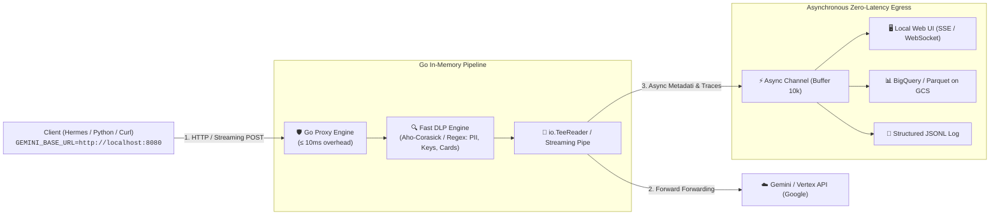

# 🛰️ Gemini Transparent Telemetry & DLP Proxy (Spec)

> **Document Status:** Draft Specification  
> **Author:** Riccardo Carlesso & Ermete Bottazzi 🚛  
> **Date:** 2026-10-16  
> **Tags:** `#software-ideas`, `#gemini`, `#gcp`, `#proxy`, `#golang`, `#dlp`, `#evals`, `#telemetry`

---

## 1. Core Concept
Un reverse proxy trasparente ad altissime prestazioni scritto in **Go** (o Rust) per chiamate Gemini / Vertex AI / OpenAI / Anthropic. 
- In **Locale (`localhost:8080`)**: gira come sidecar/demone locale con web UI real-time (SSE/WebSocket) per ispezionare prompt, token, latenze e traiettorie delle conversazioni al volo.
- In **Cloud Run**: riceve il traffico da molteplici progetti/client/API keys, aggancia metadati unificati (`X-Session-ID`, `X-Trajectory-ID`), redige dati sensibili via DLP prima che lascino il perimetro, e invia tracce asincrone su GCS / BigQuery / OpenTelemetry senza subire i ritardi di Cloud Logging.
- **Overhead di Latenza:** $\le 10-25\text{ ms}$. Zero buffering bloccante sugli stream (SSE).

---

## 2. The Problem & Context
1. **Dispersione dei Client:** Riccardo usa Gemini da mille posti diversi (laptop derek, mini-lobby, Mac fisse, Cloud Run, Cloud Functions, CLI script in Python/Ruby/Bash) con decine di API keys e Google Cloud Projects differenti.
2. **Cloud Logging Lag & Sluggishness:** Cloud Logging è mastodontico, costoso e spesso ha ritardi di ingestione (decine di secondi o minuti) che rendono il debugging interattivo un incubo.
3. **Mancanza di Tracce End-to-End Server-Side su Vertex:** Vertex AI non traccia in modo trasparente e strutturato la catena delle conversazioni (multi-turn trajectories) a livello gateway.
4. **Data Leakage (PII / Carte di Credito / API Keys):** Spesso chiavi private, token o dati confidenziali rischiano di finire nei prompt inviati agli LLM. Serve un filtro DLP deterministico a monte.

---

## 3. Open Source Landscape & Benchmarks

| Soluzione | Linguaggio | Latenza Aggiunta | Pro | Contro |
| :--- | :--- | :--- | :--- | :--- |
| **Helicone** | Cloudflare Workers / Rust / Go | ~10-15 ms | Interfaccia spettacolare, session tracking nativo tramite header (`Helicone-Session-Id`), open-source. | Pensato originariamente per OpenAI/Anthropic, supporto Vertex richiede configurazione custom. |
| **Envoy AI Gateway** (CNCF) | Go / C++ | < 5 ms | Standard enterprise, filtri estensibili, rate limiting, token tracking. | Più pesante da configurare e mantenere per uso dev locale rapido. |
| **Portkey AI Gateway** | TypeScript / Rust | ~10-20 ms | Fallback, load balancing, logging centralizzato. | Molto incentrato sul cloud proprietario, UI open-source parziale. |
| **LiteLLM Proxy** | Python | 40-100 ms | Supporta 100+ provider out of the box, UI carina. | Scritto in Python (troppo lento per il target di 10-20ms), runtime pesante. |
| **Custom Go Micro-Proxy (`gemini-proxy`)** | **Go (Standard `httputil`)** | **< 8 ms** | Leggerissimo, binario unico statico, zero dipendenze pesanti, UI HTML/JS embedded, DLP client-side custom. | Da mantenere internamente. |

---

## 4. Proposed Architecture: `gemini-telemetry-proxy` (Go)



### Pipeline Details:
1. **Zero-Copy Streaming (`io.TeeReader`):**
   - Non aspetta la fine dello streaming SSE per inoltrare la risposta al client. Il client riceve i token a zero latenza.
   - Il proxy accumula il testo in background in un buffer per estrarre: `prompt_tokens`, `completion_tokens`, `model`, `finish_reason`, `latency_ms`.
2. **DLP & PII Masking Client-Side:**
   - Motore basato su `config.yaml`:
     ```yaml
     dlp:
       block_on_credit_card: true
       redact_patterns:
         - pattern: "AIzaSy[A-Za-z0-9_-]{33}"
           replace: "[REDACTED_GEMINI_KEY]"
         - pattern: "ghp_[A-Za-z0-9]{36}"
           replace: "[REDACTED_GH_TOKEN]"
     ```
   - Esecuzione in microsecondi tramite tabelle regex precompilate o algoritmi a pattern multiplo (Aho-Corasick).
3. **Multimodal Media Handling (Audio, Immagini, Video):**
   - Se il payload supera 100 KB o contiene dati binari `inline_data`:
     - Il log testuale registra solo il puntatore: `[MEDIA: image/jpeg 1.2MB sha256:abc...]`.
     - Se `save_media_to_gcs: true`, il proxy scarica asincronamente il blob su un bucket GCS dedicato (`gs://ricc-gemini-telemetry/blobs/...`) e inserisce l'URI nella traccia. Il logging testuale resta snello e rapidissimo.

---

## 5. Local Web UI (Dev Mode)
In locale con `./gemini-proxy --dev`:
- Serve un frontend embedded (HTML5/Tailwind/Vanilla JS servito direttamente dal binario Go tramite `embed.FS`).
- Connesso via **Server-Sent Events (SSE)** all'endpoint `/api/events`.
- Ogni chiamata appare istantaneamente con un "pum!":
  * Badge del Modello (`gemini-2.5-flash`, `gemini-3-pro-image`)
  * Traccia / Session ID (`X-Session-ID`)
  * Latenza (Time-to-First-Token + Latenza Totale)
  * Token In / Token Out e Costo stimato ($)
  * Accordion con Prompt e Risposta (con dati sensibili redatti evidenziati in giallo)

---

## 6. Configurazione & Adozione Client Trasparente
Nessun cambio di codice nei client! Solo variabili d'ambiente:
```bash
# In Dev (locale)
export GEMINI_API_BASE="http://localhost:8080"
export GOOGLE_GENAI_BASE_URL="http://localhost:8080"

# In Prod (Cloud Run)
export GEMINI_API_BASE="https://gemini-proxy-xyz.europe-west1.run.app"
```

---

## 7. Next Steps & Action Items
1. Testare **Helicone open-source proxy** in un container locale per valutare se la UI esistente soddisfa il 90% del caso d'uso.
2. Se serve il DLP stretto custom e l'egress leggero su GCS, creare il prototipo in Go (`~/git/gemini-telemetry-proxy`) con `gin` o `chi` + `httputil.ReverseProxy`.
