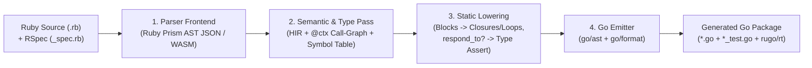

# Rugo (*aka Goby*): Ahead-of-Time Static Ruby-to-Go Transpiler

> **Implementation Status**: Preliminary prototype and RSpec test suite drafted on Riccardo's Mac / `mini-lobby` (tracked from Septober `#245`); target GitHub repository [`github.com/palladius/rugo`](https://github.com/palladius/rugo) (`~/git/rugo`) to be initialized/synced — see [`blueprint.yaml`](blueprint.yaml).  
> **Naming Note**: Internally nicknamed **Rugo** (*Ruby -> Go*) and **Goby**. We standardize on `rugo` as the primary binary and repository slug because [`goby-lang/goby`](https://github.com/goby-lang/goby) already exists in public OSS as an archived bytecode VM.

## Problem Statement

Ruby maximizes authorial velocity and readability—concise classes, expressive blocks/enumerables, `:symbols`, and clean RSpec tests—making it Riccardo's favorite language for CLIs, scripts, and orchestration glue. Go maximizes operational performance—single static binaries, millisecond cold starts on Cloud Run, native concurrency, explicit `context.Context` propagation, and compile-time type safety—at the cost of verbose boilerplate.

Bridging the two with a runtime Ruby VM written in Go (`goby-lang`, `mruby` cgo bindings) sacrifices static binary simplicity, Go ecosystem interoperability, and native execution speed because dynamic method lookup (`respond_to?`, `method_missing`, open classes) stays alive at runtime.

**Rugo** takes the opposite stance: compile a disciplined, statically analyzable subset of Ruby (**"Rugo Ruby"**) **ahead-of-time into clean, idiomatic, `gofmt`-formatted Go source code** with zero VM overhead.

---

## Goals & Non-Goals

### Goals
- **Idiomatic, Readable Go Output**: Emit human-readable Go 1.23+ source (`go/ast` + `go/format`) that compiles directly with `go build` and links natively against the Go standard library and third-party Go modules.
- **Zero Dynamic Dispatch Overhead**: Statically eliminate slow Ruby runtime reflection (`respond_to?`, `method_missing`, `send`) at transpile time via structural Go interfaces, constant folding, or actionable compile-time diagnostics.
- **Ergonomic Implicit Context (`@ctx`)**: Allow Ruby code to reference `@ctx` naturally while automatically threading `ctx context.Context` as the first parameter across generated Go function signatures and I/O calls.
- **First-Class Blocks & Symbols**: Lower Ruby blocks/iterators into zero-allocation loops, `iter.Seq` (Go 1.23 range-over-func), or typed Go closures, and lower `:symbols` into typed Go `const` values or `unique.Handle[string]` interned handles.
- **RSpec-Driven Verification**: Support a deterministic golden-file test pipeline (`*.rb` -> `*.go.golden`) and transpile core RSpec `describe`/`it`/`expect` suites directly into table-driven/subtest `*_test.go` files.

### Non-Goals
- **100% MRI Ruby Compatibility / Rails Transpilation**: Rugo does not aim to compile ActiveSupport, Rails magic, `eval`, runtime monkey-patching of open classes after definition, or C extensions.
- **Bytecode Interpreter or Embedded VM**: Rugo never ships an interpreter loop at runtime; if a construct cannot be lowered statically to Go types/interfaces, compilation fails fast with source line/column spans.
- **Replacing Full Gradual Typecheckers**: Rugo uses lightweight local type inference plus minimal optional RBS/YARD/comment hints (`#: (String) -> Integer`), rather than reimplementing all of Sorbet.

---

## Technical Plan / Architecture



### Pipeline Stages
1. **Frontend (`Prism` AST)**: Parse `.rb` files via Ruby's official `Prism` parser (invoked via JSON AST dump during bootstrap, or `go-prism` WASM/C-free binding once self-hosted) to guarantee 100% accurate Ruby 3.3+ syntax parsing.
2. **Typed HIR & Whole-Package Analysis**:
   - Collect class/module definitions into Go `struct` and `interface` declarations (closed-world per package).
   - Infer local variable and return types via literal propagation + optional RBS inline comments (`#: (String, count: Integer) -> Array[String]`).
   - Compute two transitive method effects across the call graph:
     1. **`uses_ctx`**: whether the method (or any callee) reads `@ctx` or invokes a context-aware Go stdlib boundary.
     2. **`can_raise`**: whether the method `raise`s or calls a fallible `(T, error)` function.
3. **Go AST Codegen & Minimal Runtime (`rugo/rt`)**:
   - Emit pure Go code via `go/ast` and format via `go/format`.
   - Keep `rugo/rt` tiny (< 300 LOC, zero external deps): generic slice/map helpers (`rt.Map`, `rt.Filter`) only when inlining is undesirable, plus symbol interning aliases.

---

## Core Language Semantic Mappings

### 1. Implicit Context (`@ctx`) -> `ctx context.Context`

In Ruby, threading `ctx` through every method argument destroys readability. In Rugo, `@ctx` is a reserved lexical/instance capability:

- Any method reading `@ctx`—or calling another method marked `uses_ctx`—automatically receives `ctx context.Context` as its **first Go parameter**.
- Entrypoints (`main` or top-level CLI runners) initialize `ctx := context.Background()` (or `signal.NotifyContext`), while `@ctx.with_timeout(5.seconds) { ... }` lowers to `ctx, cancel := context.WithTimeout(ctx, 5*time.Second); defer cancel()`.

```ruby
# Input: fetcher.rb
class UserFetcher
  def fetch_profile(id)
    Http.get(@ctx, "https://api.example.com/users/#{id}")
  end
end
```

```go
// Output: fetcher.go
type UserFetcher struct{}

func (u *UserFetcher) FetchProfile(ctx context.Context, id string) (string, error) {
	return httpclient.Get(ctx, fmt.Sprintf("https://api.example.com/users/%s", id))
}
```

### 2. Blocks & Yield -> Go Loops, Closures & `iter.Seq`

| Ruby Construct | Lowered Go Representation | Rationale |
| :--- | :--- | :--- |
| `items.each { \|x\| ... }` / `.map` / `.select` | Native `for _, x := range items { ... }` | Zero closure allocation, supports outer `return` and error propagation naturally. |
| `def with_lock(&block)` (`yield`) | Higher-order `func(..., fn func() error) error` | Preserves lexical variable capture (`:=` by reference in Go closures) and `defer` cleanup. |
| Custom streaming enumerator (`def each_row`) | Go 1.23+ `iter.Seq[Row]` (`func(yield func(Row) bool)`) | Enables native `for row := range repo.EachRow(ctx)` composition. |
| `Proc.new` / `->(a, b) { a + b }` | Typed closure `func(a int, b int) int { return a + b }` | Direct 1:1 closure lowering. |

### 3. Symbols (`:sym`) -> Compile-Time Constants & String Interning

Ruby symbols serve two distinct roles, and Rugo optimizes both:

1. **Closed/Static Symbols (Default — Zero Overhead)**: All literal symbols (`:ok`, `:not_found`, `:pending`) discovered in the compilation unit are emitted into a deterministic constant table (`sym.go`). Switch statements (`case status; when :ok ...`) compile to flat Go `switch` blocks.
2. **Dynamic Symbols (`str.to_sym`) — `unique.Handle[string]` Interning**: Using Go 1.23's standard `unique` package, Rugo defines `type Symbol = unique.Handle[string]`.
   - Literal `:ok` initializes once at package init: `var SymOk = unique.Make("ok")`.
   - Dynamic `str.to_sym` lowers to `unique.Make(str)`.
   - Equality `sym1 == sym2` is a single pointer/word comparison ($O(1)$), `.to_s` lowers to `sym.Value()`, and garbage collection of unused dynamic symbols comes free from Go's runtime!

### 4. Eliminating `respond_to?` and `method_missing`

Dynamic method lookup is the #1 enemy of AOT Go compilation and predictable latency:

- **`obj.respond_to?(:serialize)`**:
  - **Known Concrete Receiver**: Evaluated statically at compile time and constant-folded (`true` or `false`), pruning dead `if/else` branches cleanly.
  - **Interface / Union Receiver (`any`)**: Lowered to a zero-reflection Go structural interface assertion:
    ```go
    if s, ok := obj.(interface{ Serialize() ([]byte, error) }); ok {
        // narrowed variable `s` available inside branch!
    }
    ```
  - **Dynamic Symbol Argument (`obj.respond_to?(user_input.to_sym)`)**: Rejected at compile time (`RUGO_E002: respond_to? requires a compile-time symbol literal`).
- **`method_missing`**:
  - **Hard Compile-Time Error (`RUGO_E001`)**: Arbitrary `def method_missing(name, *args)` is forbidden. The compiler suggests idiomatic replacements:
    1. Go struct embedding / `Forwardable` (`def_delegators :@client, :get, :post` -> promoted struct methods),
    2. Explicit typed `Hash[Symbol, T]` / `Struct` fields instead of `OpenStruct`,
    3. Compile-time macro/struct generation from known keys.

### 5. Exceptions (`raise` / `rescue`) -> Idiomatic `(T, error)`

- `raise ArgumentError, "bad id"` lowers to `return zero, fmt.Errorf("ArgumentError: bad id")`.
- Any call inside a `can_raise` chain inserts `if err != nil { return ..., err }` automatically unless wrapped in a `begin ... rescue => e ... end` block, which binds `err` locally without stack-unwinding `panic`/`recover`.

---

## Testing Plan: RSpec -> Go Golden Files & Behavioral Parity

Since preliminary RSpec tests already exist for Rugo's initial rules, testing operates at two levels:

### Level 1: Golden File Transpilation Suite (`testdata/golden/`)
Each fixture directory `testdata/golden/<feature>/` contains:
- `input.rb` — Ruby source exercising a targeted feature (`01_ctx_propagation`, `02_blocks_closures`, `03_symbols_intern`, `04_respond_to_narrowing`, `05_reject_method_missing`).
- `expected.go.golden` (or `expected.err.golden` for negative compile-time error cases like `RUGO_E001`).
- Automated test runner:
  1. Transpiles `input.rb` -> `actual.go`.
  2. Diffs `actual.go` byte-for-byte against `expected.go.golden` (refreshable via `RUGO_UPDATE_GOLDEN=1 go test ./...`).
  3. Runs `go vet` and `go build` on `actual.go` in an ephemeral workspace to prove every golden file actually compiles!

### Level 2: RSpec Transpiler & Dual-Runner Parity (`spec/*_spec.rb` -> `*_test.go`)
Rugo includes a dedicated RSpec AST profile so unit specs written in Ruby compile to native `testing.T`:
- `RSpec.describe Foo do ... end` -> `func TestFoo(t *testing.T) { ... }`
- `context "..."` / `it "..."` -> `t.Run("...", func(t *testing.T) { ... })`
- `let(:user) { User.new("ricc") }` -> lazy per-subtest helper closure reset on each `t.Run`.
- `expect(actual).to eq(expected)` -> `if !reflect.DeepEqual(actual, expected) { t.Fatalf(...) }`.
- **Parity Gate**: CI executes both `bundle exec rspec` (against MRI Ruby with a tiny `@ctx` shim) and `go test ./...` (against transpiled Go) on the shared conformance suite to guarantee identical runtime semantics.

---

## Alternatives Considered

- **`goby-lang/goby` (Archived)**: Bytecode VM in Go with Ruby-like syntax. Rejected because shipping a VM forfeits native Go speed, static type checking, and seamless Go package imports.
- **`mruby` + `cgo`**: Embeds C Ruby inside Go. Rejected due to `cgo` cross-compilation pain, GC boundary friction, and keeping slow dynamic dispatch alive.
- **Crystal**: Ruby-inspired AOT compiled language on LLVM. Great language, but produces LLVM binaries isolated from the Go ecosystem (`context.Context`, goroutines, GCP Go SDKs) rather than readable `.go` source.

---

## Implementation Plan (Target Repo: `~/git/rugo`)

1. **Phase 0 — Sync Existing Prototype**: Import the existing Mac / `mini-lobby` prototype and preliminary RSpec specs into `github.com/palladius/rugo`.
2. **Phase 1 — Core Pipeline & Golden Harness**: Wire `Prism` JSON AST ingestion -> HIR -> `go/ast` emitter + `testdata/golden/` runner (`go build` verified).
3. **Phase 2 — Core 4 Pillar Lowerings**: Implement `@ctx` call-graph threading, `:symbol` -> `unique.Handle[string]`/`const`, inlined enumerable blocks + closure capture, and static `respond_to?` interface narrowing + `RUGO_E001` `method_missing` guard.
4. **Phase 3 — RSpec Lowering & Self-Test**: Transpile the preliminary RSpec suite to `*_test.go` and enforce dual MRI/Go parity in GitHub Actions.

## Open Questions

1. **Bootstrap Language**: Is the existing Mac/`mini-lobby` prototype written in **Ruby** (using `Prism` directly to emit `.go`—super fast to iterate with existing RSpec tests!) or already in **Go**? *(Note: starting the transpiler in Ruby using native `Prism` + RSpec and later self-hosting Rugo-in-Rugo is a classic compiler milestone!)*
2. **Visibility & Repo Name**: Should we initialize `github.com/palladius/rugo` as **private** first (via `gh repo create palladius/rugo --private`) when syncing the prototype from Mac/`mini-lobby`?
3. **Type Annotations**: For method parameters where local inference isn't enough, do you prefer **RBS inline comments** (`#: (String) -> Integer`), **Sorbet `sig`**, or lightweight **Ruby 3 endless/keyword defaults** (`def fetch(id: String)`)?
